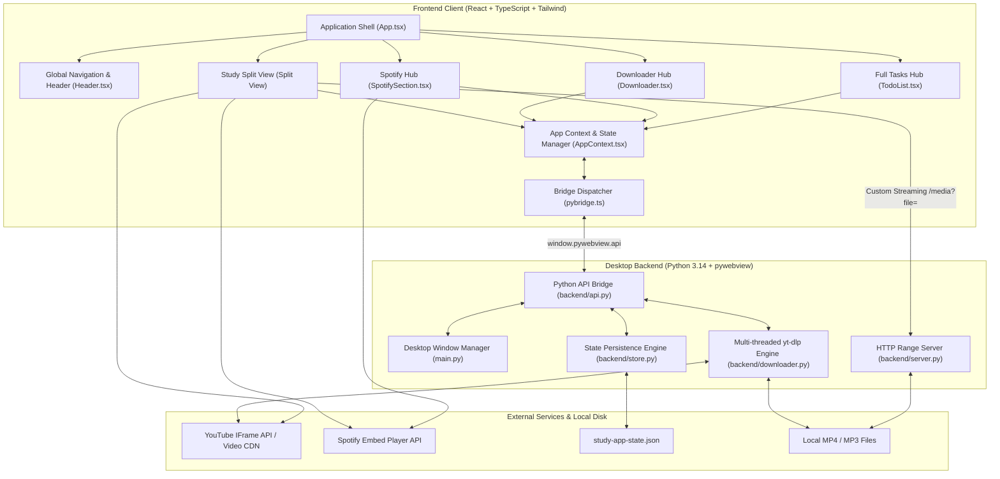
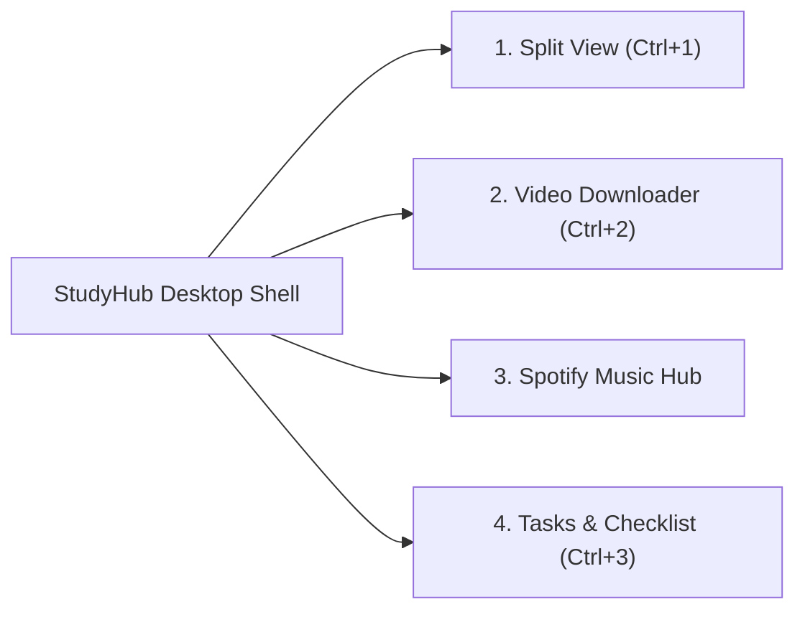
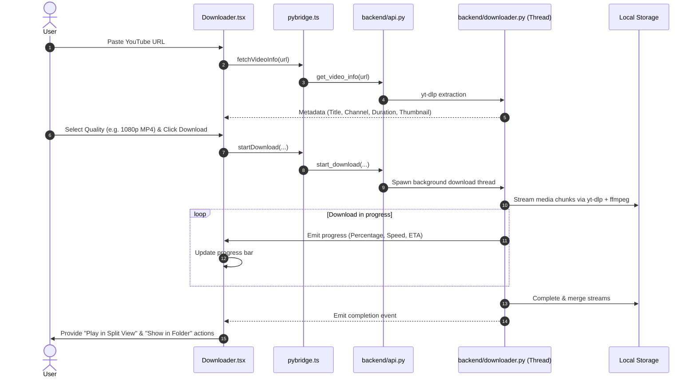
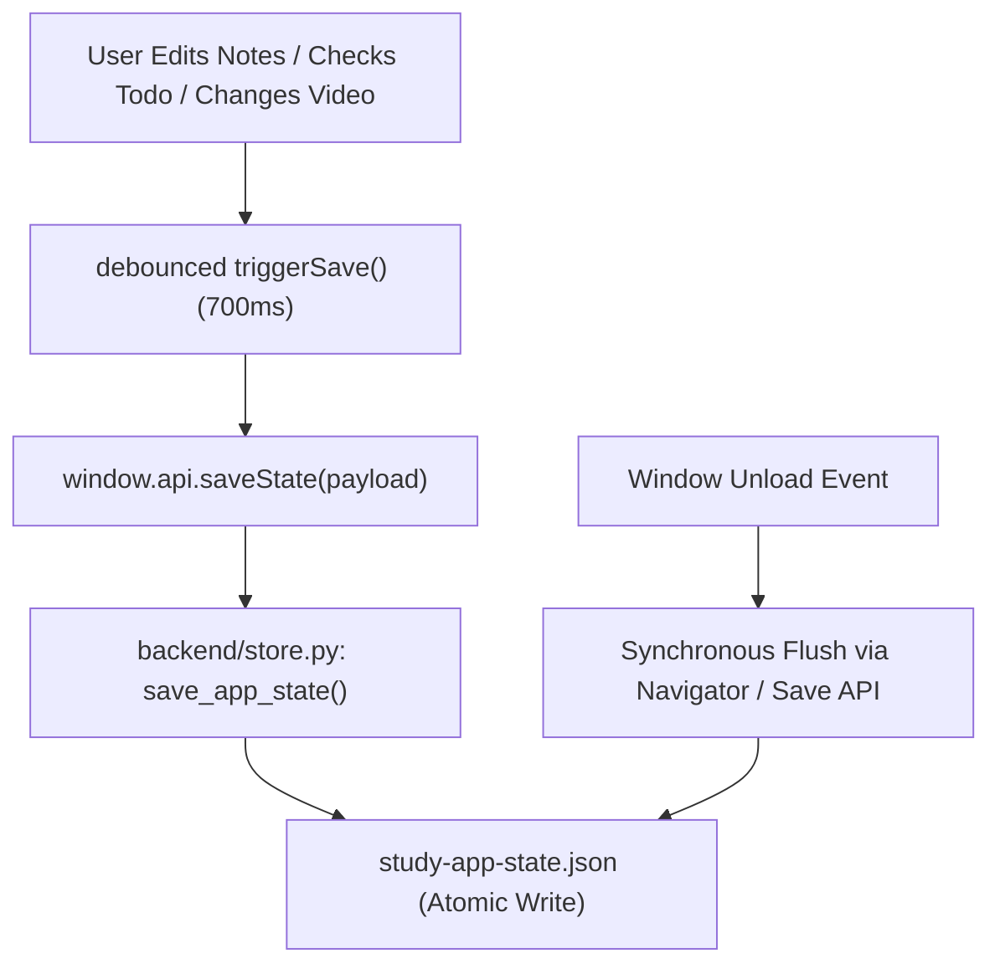

# StudyHub Desktop - Comprehensive Architecture & Operational Guide

StudyHub Desktop is a high-performance desktop study application combining video streaming, ambient focus music, offline video playback, rich-text note-taking with two-way clickable timestamp synchronization, persistent task management, and multi-threaded video downloading.

Built using a hybrid native-web stack:
- **Frontend:** React 18, TypeScript 5, Vite 8, Tailwind CSS, Lucide React Icons
- **Backend Core:** Python 3.14, Microsoft Edge WebView2 (`pywebview`), `yt-dlp`, `imageio-ffmpeg`
- **Streaming Engine:** Python `ThreadingHTTPServer` with HTTP 206 Partial Content Byte-Range request support
- **State Store:** Debounced atomic JSON serialization (`study-app-state.json`)

---

## 1. High-Level Architecture & Communication

StudyHub Desktop pairs a native Python desktop runtime with a modern, hardware-accelerated Microsoft Edge WebView2 browser window.



### The Communication Bridge (IPC)
1. **Frontend to Python:** Calls from React execute asynchronously through `window.api` (wrapped in `src/utils/pybridge.ts`), which routes into `StudyHubApi` methods defined in `backend/api.py`.
2. **Python to Frontend:** Background threads (such as `yt-dlp` download workers) emit progress updates via `window.evaluate_js()`, dispatching custom window events (`pybridge:downloadProgress`, `pybridge:downloadComplete`, `pybridge:downloadError`) that React listens to in `AppContext.tsx`.
3. **Local Media Streaming:** To enable smooth scrubbing and video seeking without loading entire video files into memory, `backend/server.py` implements a custom endpoint `http://127.0.0.1:{port}/media?file={path}` handling `HTTP 206 Partial Content` (Range: `bytes=start-end`).

---

## 2. Deep Dive: All Application Sections



---

### Section 1: Study Split View (The Integrated Study Cockpit)

The Split View (`src/components/YouTubeViewer.tsx` & `src/components/NotesEditor.tsx`) is the core workspace where lecture watching and note-taking occur simultaneously.

#### A. Left Media Pane & 3-Way Source Switcher
The header of the media pane features a source switcher:
- **YouTube Mode:**
  - Enter any YouTube URL or 11-character video ID.
  - Features precise **5-second rewinding (`-5s`)** and **fast-forwarding (`+5s`)** buttons.
  - Playback speed selectors: `0.75x`, `1x`, `1.25x`, `1.5x`, `2x`.
  - Recent Videos Drawer: Revisit previously watched study lectures.
  - Downloads Dropdown: Open any completed offline download directly into the player.
- **Spotify Music Mode:**
  - Embeds the official Spotify web player inside the media pane.
  - Focus preset chips: One-click buttons for *Deep Focus, Lofi Beats, Peaceful Piano, Chill Lofi, Intense Studying, Brain Food*.
  - Universal loader: Paste any playlist, album, track, artist, or podcast link.
  - **"Pin to Notes" Button:** Inserts a stylized link into your notes editor linking to the active Spotify soundtrack.
- **Offline / Local Video Mode:**
  - Streams local video files (`.mp4`, `.mkv`, `.webm`, `.avi`, `.mov`) through the built-in HTTP Range server.
  - Supports native seeking, speed adjustments, and timestamp generation.
  - "Browse PC..." native Windows file picker.

#### B. Draggable Split Resizer (`src/components/SplitResizer.tsx`)
- Drag the center divider to customize the ratio between media and notes (between 25% and 75% width).
- Displays a real-time percentage badge during drag.
- Automatically saves the chosen split ratio to disk.

#### C. Right Notes Pane & Interactive Timestamp Sync
- **Interactive Timestamp Linking:**
  - Clicking **Insert Timestamp** (or pressing `Ctrl+Shift+T`) inserts a timestamp badge into your notes (e.g. `⏱️ 05:20`).
  - Clicking any timestamp tag inside your notes commands the video player to jump to that exact second.
- **Rich-Text Formatting:**
  - Headings (H1, H2, H3), Bold, Italic, Underline, Strikethrough, Code Blocks, Blockquotes, Highlights.
  - Bulleted lists and numbered lists.
- **Multi-Document Notebook Tabs:**
  - Create multiple pages (`+ New Page`), rename active notes, and switch between subject notebooks.
- **Export Capabilities:**
  - Export to Markdown (`.md`), Plain Text (`.txt`), or Print/Export to PDF.
- **Live Metrics:** Word count, character count, and debounced auto-save status indicator.

#### D. Collapsible Study Tasks Drawer
- An inline task checklist below the notes editor for tracking session objectives without leaving the workspace.

---

### Section 2: Video Downloader Hub (`src/components/Downloader.tsx`)

A dedicated interface for saving online lectures for offline study.



#### Key Capabilities:
- **Multi-Threaded Engine:** Powered by Python's `yt-dlp` running on independent daemon threads.
- **Quality & Format Options:**
  - Video MP4: `1080p Full HD`, `720p HD`, `480p SD`, `360p Low`.
  - Audio Only: `MP3 (High Quality 320kbps)`.
- **Live Telemetry:** Tracks download percentage, transfer speed (e.g. `4.2 MB/s`), remaining time (ETA), and file size.
- **Session-Only History:** Download history is kept in memory during the active session and omitted from disk writes, keeping your workspace clean.
- **Direct Integration:** One-click button to open downloaded videos directly in the Split View player.

---

### Section 3: Spotify Music Hub (`src/components/SpotifySection.tsx`)

A full-screen dashboard dedicated to ambient focus music and study soundtracks.

- **8 Curated Study Presets:**
  1. 🎧 **Deep Focus** — Atmospheric electronics for deep work.
  2. ☕ **Lofi Beats** — Relaxed beats for casual study.
  3. 🎹 **Peaceful Piano** — Calming acoustic piano.
  4. 🛋️ **Chill Lofi Study** — Mellow downtempo instrumentals.
  5. ⚡ **Intense Studying** — High-energy electronic flow beats.
  6. 🌿 **Ambient Chill** — Nature textures and soundscapes.
  7. 🌧️ **White Noise & Rain** — Acoustic masking for noisy environments.
  8. 🧠 **Brain Food** — Rhythmic focus audio.
- **Universal URL/URI Parser (`src/utils/spotify.ts`):** Converts standard URLs (`open.spotify.com/...`), URIs (`spotify:...`), and IDs into clean embed players.
- **"Study with this in Split View" Button:** Transitions the selected playlist to the Split View media pane alongside your notes with one click.
- **Recent Playlists:** Tracks your recently listened study soundtracks.

---

### Section 4: Tasks & Checklist Hub (`src/components/TodoList.tsx`)

A full-screen task management dashboard for organizing course assignments, exam preparation, and study goals.

- **Priority Tagging:** High (Red), Medium (Amber), and Low (Blue) visual priority badges.
- **Due Dates & Overdue Indicators:** Color-coded deadline badges.
- **Filter Tabs:** Filter tasks by *All*, *Pending*, *Completed*, or by priority (*High*, *Medium*, *Low*).
- **Search:** Instant keyword search across all tasks.
- **Bulk Actions:** One-click clear completed tasks.

---

## 3. Data Persistence & Auto-Resume Engine

All user data is managed through an auto-save pipeline:



### Stored State Structure (`study-app-state.json`)
```json
{
  "video": {
    "url": "https://www.youtube.com/watch?v=...",
    "videoId": "...",
    "title": "...",
    "currentTime": 120,
    "sourceType": "youtube",
    "localFilePath": "",
    "recentVideos": [...]
  },
  "notes": {
    "title": "Session Notes",
    "content": "<p>Notes HTML...</p>",
    "lastSaved": "2026-11-20T11:00:00.000Z",
    "activeNoteId": "note-1",
    "documents": [...]
  },
  "todos": [...],
  "settings": {
    "downloadFolder": "C:\\Users\\...\\Downloads",
    "splitRatio": 52,
    "activeTab": "split"
  },
  "spotify": {
    "currentUri": "playlist/37i9dQZF1DWZeKCadgRdKQ",
    "embedUrl": "https://open.spotify.com/embed/playlist/...",
    "title": "Deep Focus",
    "recentItems": [...]
  },
  "downloads": []
}
```

---

## 4. Codebase Directory Map

```
d:\Study App\
├── main.py                     # Native desktop entry point (pywebview + server init)
├── backend/
│   ├── __init__.py             # Backend Python package
│   ├── api.py                  # JS-accessible Python API (StudyHubApi)
│   ├── downloader.py           # Multi-threaded yt-dlp download pipeline
│   ├── server.py               # Local HTTP 206 Partial Content Range server
│   └── store.py                # State persistence engine (study-app-state.json)
├── src/
│   ├── main.tsx                # React application mount point
│   ├── App.tsx                 # Root component & tab switching
│   ├── index.css               # Tailwind CSS rules & dark mode styling
│   ├── types/
│   │   └── app.ts              # TypeScript interfaces & state schemas
│   ├── context/
│   │   └── AppContext.tsx       # Central state provider & action dispatcher
│   ├── utils/
│   │   ├── pybridge.ts         # Type-safe JavaScript-to-Python API bridge
│   │   ├── youtube.ts          # YouTube ID parser & timestamp formatter
│   │   └── spotify.ts          # Spotify URL/URI parser & curated presets
│   └── components/
│       ├── Header.tsx          # Navigation header, save badge & settings modal
│       ├── YouTubeViewer.tsx   # Media pane (YouTube, Spotify, Offline Video)
│       ├── NotesEditor.tsx     # Rich-text editor with timestamp seeking
│       ├── Downloader.tsx      # Video downloader user interface
│       ├── TodoList.tsx        # Tasks & checklist management view
│       ├── SplitResizer.tsx    # Draggable horizontal split view divider
│       └── SpotifySection.tsx  # Full-page Spotify music dashboard
├── dist/                       # Compiled production frontend assets
├── StudyHub.bat                # Windows Batch launcher
├── StudyHub.vbs                # Silent launcher script
├── StudyHub.lnk                # Windows Desktop Shortcut
├── requirements.txt            # Python dependencies (pywebview, yt-dlp, pillow)
├── package.json                # Node.js dependencies & build scripts
├── vite.config.ts              # Vite configuration
└── DOCUMENTATION.md            # This comprehensive documentation file
```

---

## 5. Global Keyboard Shortcuts

| Shortcut | Action | Description |
| :--- | :--- | :--- |
| `Ctrl + 1` | **Split View** | Switch to the dual-pane media and note-taking workspace. |
| `Ctrl + 2` | **Downloader** | Switch to the offline video downloader. |
| `Ctrl + 3` | **Tasks** | Switch to the full-screen task management dashboard. |
| `Ctrl + S` | **Save State** | Immediately flush all notes, tasks, and settings to disk. |
| `Ctrl + Shift + T` | **Insert Timestamp** | Insert a clickable video bookmark (`⏱️ mm:ss`) into active notes. |

---

## 6. How to Run & Build

### Launch the App
- **Quick Launch:** Double-click **`StudyHub.lnk`** on your Desktop or run **`StudyHub.bat`**.
- **Terminal:**
  ```powershell
  python main.py
  ```

### Recompile Frontend (After Making UI Changes)
```powershell
npm run build
```
*(Runs TypeScript validation with `tsc -b` and bundles assets via `vite build` into `dist/`)*

